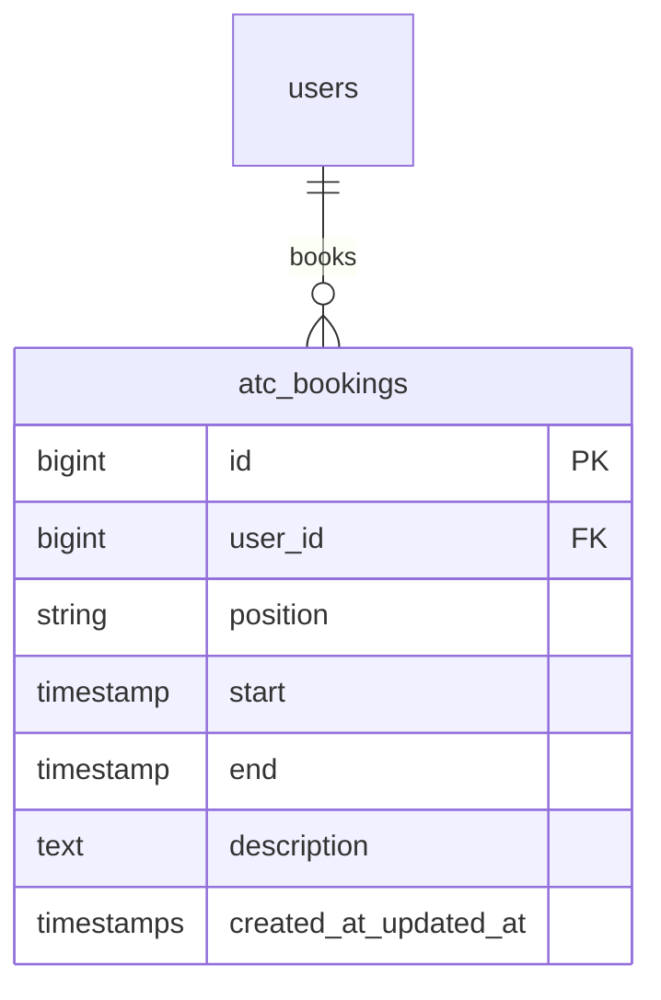

# ATC Bookings

## Purpose

This document describes how rostered controllers book a position ahead of time and how
those bookings appear in the controller schedule on the home page. It is written for
developers and contributors working on the booking form or the schedule widget.

## Key concepts

- **A booking** says that a controller plans to work a position (for example `JAX_CTR`)
  from a start time to an end time, with an optional note.
- **Rostered controllers book.** Creating a booking needs the `create atc booking`
  permission, which `PermissionSeeder` grants to the `rostered` role.
- **The schedule is public.** The home page's "Controller Schedule" card lists one day's
  bookings at a time, with previous and next day buttons.
- **Owners and staff can edit.** A booking can be edited or deleted by the controller who
  made it, or by anyone with the `staff` role.
- **Limits:** a booking can't start in the past and can't be longer than five hours.
  Positions are stored uppercased.

## Data model

- `description` is nullable (max 1000 on input).
- `start` and `end` are cast to `datetime`.
- `user_id` has a foreign key to `users` with no cascade, so a user with bookings can't
  be deleted until their bookings are removed.

## Flows

### 1. Book a session

1. On the home page, users with `create atc booking` see a "Book a Session" button. It
   opens a modal from the `atc-booking-form` Blade component.
2. The form posts to `POST /bookings` → `AtcBookingController::store()`. Validation
   requires a `position` (max 255), a `start` that isn't in the past, an `end` after
   `start` and no more than five hours later, and an optional `description`
   (max 1000).
3. The booking is saved with the position uppercased, and the user is redirected home.

### 2. View the schedule

The `controller-schedule` Livewire component (`app/Livewire/ControllerSchedule.php`) shows
the bookings that *start* on the selected date, in start order, with the controller's
name. It opens on today. `previousDay()` and `nextDay()` move one day at a time.

### 3. Edit or delete

The component's `edit()`, `update()`, and `delete()` actions each load the booking and
check `ControllerSchedule::canManage()`: the current user must own the booking or have
the `staff` role. Otherwise they get a 403. Edits use the same five-hour limit.

## Permissions & middleware

| Action | Requirement |
| --- | --- |
| See the schedule | None (home page). |
| Create (`POST /bookings`) | `permission:create atc booking` |
| Edit or delete (Livewire) | Booking owner, or the `staff` role (`canManage()`) |

## Key files

| Path | Role |
| --- | --- |
| `app/Http/Controllers/AtcBookingController.php` | Create. |
| `app/Livewire/ControllerSchedule.php` | Day view, edit, delete, `canManage()`. |
| `app/Models/AtcBooking.php` | Model. |
| `resources/views/components/atc-booking-form.blade.php` | Booking modal. |
| `resources/views/livewire/controller-schedule.blade.php` | Schedule view. |
| `resources/views/home.blade.php` | Hosts the schedule card. |
| `database/migrations/*_create_atc_bookings_table.php` | Table. |
| `tests/Feature/AtcBookingTest.php` | Feature tests. |

## Gotchas

- **Bookings are site-only.** Nothing here is sent to VATSIM or VATUSA, and nothing checks
  for overlapping bookings on the same position.
- **The schedule groups by start date.** A booking that runs past midnight only appears
  on the day it starts.
- **Edits don't re-check "not in the past".** That rule only applies on create.
- **Old bookings aren't cleaned up.** No job prunes past bookings.
- **Livewire actions check permissions themselves.** The schedule lives on a public page,
  so every action that changes data must call `canManage()` (see the matching gotcha in
  [events](events.md#gotchas)).
