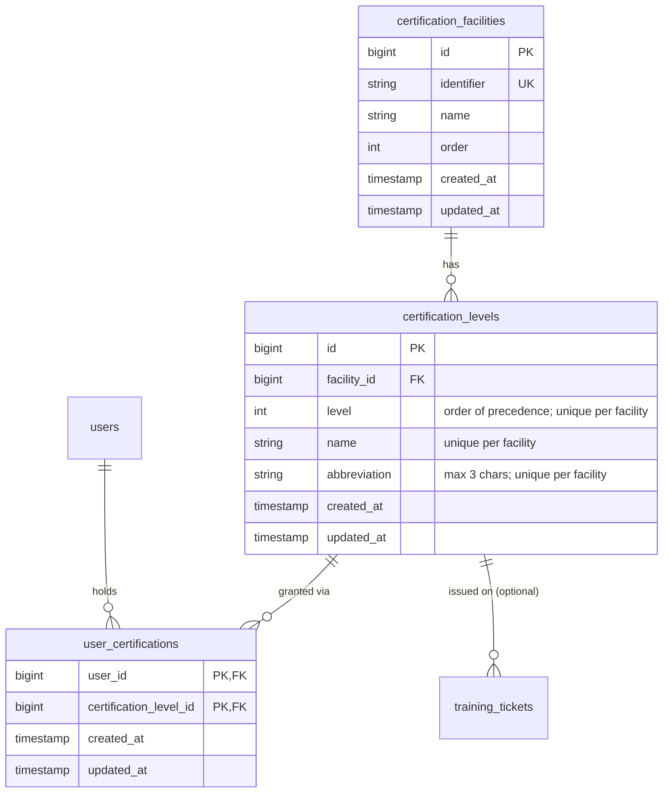

# Certifications

## Purpose

The certification system lets the Facilities department describe the ARTCC's controller
certifications, and lets instructors and admins record which certifications each user
holds. It has two layers:

- **Facilities** group related certifications (for example, a TRACON or a set of tower
  positions) and give them a short display identifier.
- **Levels** are the individual certifications inside a facility, ordered by a numeric
  `level` so a higher number means a higher qualification.

Users are linked to the levels they've earned. Those certifications appear on the roster
and on user profiles.

## Key concepts

- A **certification facility** (`CertificationFacility`) has a `name`, an `identifier`
  (always stored and read uppercased), and an `order` that sets its column position.
- A **certification level** (`CertificationLevel`) belongs to one facility. It has an
  integer `level` (order of precedence), a `name`, and an `abbreviation` of up to 3
  characters. Within a facility, `level`, `name`, and `abbreviation` are each unique.
- A **user certification** (`UserCertification`) links a user to a level. Its primary key
  is `(user_id, certification_level_id)`, so the relationship is many-to-many.
- **"Current" certification:** a user can hold several levels in one facility. Displays
  show the highest one (`User::highestCertificationLevelFor($facilityId)`).
- **Three ways to grant:** the certification manager grid, the certifications card on a
  user's edit page, and issuing one on a training ticket. All three need
  `certifications:write`.
- **Grants and revokes are audited.** `UserCertification` writes a "Certification issued"
  or "Certification revoked" entry to the audit log, with the affected user as the subject
  and the acting user as the causer.
- **Deletes cascade.** Deleting a facility removes its levels. Deleting a level removes
  the matching user certifications. Both are enforced by foreign keys.

## Data model

Notes on the schema:

- `certification_facilities.order` defaults to `0`.
- `certification_levels` has three composite unique indexes, all scoped to `facility_id`:
  `(facility_id, level)`, `(facility_id, abbreviation)`, and `(facility_id, name)`.
- `user_certifications` has **no** `id` column.
- `training_tickets.issued_certification_level_id` records the level a ticket granted, if
  any (see [training](training.md)).

### Eloquent relationships

- `CertificationFacility::certificationLevels()`: `hasMany(CertificationLevel, 'facility_id')`,
  highest `level` first.
- `CertificationLevel::facility()`: `belongsTo(CertificationFacility, 'facility_id')`.
- `CertificationLevel::userCertifications()`: `hasMany(UserCertification)`.
- `UserCertification::user()` and `::certificationLevel()`: `belongsTo`.
- `UserCertification::facility()`: `hasOneThrough` the level to its facility.
- `User::certifications()`: `hasMany(UserCertification, 'user_id')`. `User` also has
  `highestCertificationLevelFor()` and `hasCertificationLevel()`. Both work on the loaded
  relation, so eager-load `certifications.certificationLevel` to avoid a query per cell.

## Flows

### 1. Define facilities

`GET /admin/data/certification-facilities` (`CertificationFacilityController::index()`)
renders the `certification-facility-manager` Livewire component, which handles:

- **Create:** `name` (max 255), `identifier` (max 10, unique, uppercased before the
  uniqueness check), and `order`.
- **Edit inline:** the same fields and rules.
- **Delete:** cascades to the facility's levels and every user certification in them.

### 2. Define levels

`GET /admin/data/certification-facilities/{facility}` (`show()`) renders the
`certification-levels-table` component for that facility, listing its levels highest
first.

- **Add:** `createLevel()` validates `level` (integer, at least 0), `name`, and
  `abbreviation` (max 3), each unique within the facility.
- **Edit or delete a level:** each row is a `certification-level-row` component. Its
  `save()` and `delete()` dispatch `certification-level-saved` and
  `certification-level-deleted`, and the table refreshes when it receives them.

### 3. Grant and revoke

- **Certification manager:** `GET /admin/certifications` renders the
  `certification-manager` component. It's a sortable, searchable grid of users (25 per
  page) with one column per facility showing each user's highest level. Click a cell to
  open an editor for that user and facility, then toggle levels on and off
  (`toggleLevel()`).
- **User edit page:** `GET /users/{user}/edit` shows a "Certifications" card with the
  `user-certifications` component to anyone with `certifications:write`. It toggles levels
  for that one user.
- **Training ticket:** when an instructor with `certifications:write` files a training
  ticket and picks a level, `TrainingTicketController::store()` grants it
  (`firstOrCreate`) and records it on the ticket. Instructors without the permission
  can't grant a level this way.

A toggle creates the `user_certifications` row if it's missing and deletes it if it
exists.

### 4. Display

- **Roster** (`RosterController::index()`, `resources/views/roster/index.blade.php`): one
  column per facility (its `identifier`), showing the user's highest level abbreviation
  or "Uncertified".
- **User profile** (`resources/views/users/show.blade.php`): the `user-certifications`
  Blade component lists every level the user holds, grouped by facility in facility
  `order`.

## Permissions & middleware

| Route / action | Requirement |
| --- | --- |
| `GET /admin/data/certification-facilities[/{facility}]` | `admin` prefix (`view dashboard`) + `certification-facilities:write` |
| Facility and level create, edit, delete (Livewire) | `certification-facilities:write`, re-checked in each action |
| `GET /admin/certifications` | `certifications:write` only. This route sits in its own `admin`-prefixed group, without `view dashboard`. |
| Grant or revoke (both Livewire components) | `certifications:write`, re-checked in each action |
| Grant through a training ticket | Training-ticket route permissions, plus `certifications:write` on the instructor |

`PermissionSeeder` grants `certification-facilities:write` to the `facilities` role and
`certifications:write` to the `admin` and `instructor` roles. See
[authentication & authorization](../authentication-authorization.md).

## Key files

| File | Role |
| --- | --- |
| `app/Models/CertificationFacility.php` | Facility model; uppercases `identifier`; levels relation. |
| `app/Models/CertificationLevel.php` | Level model. |
| `app/Models/UserCertification.php` | User↔level join model; audit-log hooks. |
| `app/Models/User.php` | `certifications()`, `highestCertificationLevelFor()`, `hasCertificationLevel()`. |
| `app/Http/Controllers/CertificationFacilityController.php` | Facility index and show pages (page shells only). |
| `app/Livewire/CertificationFacilityManager.php` | Facility create, edit, delete. |
| `app/Livewire/CertificationLevelsTable.php` | Level list and add form. |
| `app/Livewire/CertificationLevelRow.php` | Single level edit and delete. |
| `app/Livewire/CertificationManager.php` | Grant and revoke grid across all users. |
| `app/Livewire/UserCertifications.php` | Grant and revoke for one user (edit page). |
| `app/Http/Controllers/Training/TrainingTicketController.php` | Grants a level from a ticket. |
| `app/Http/Controllers/RosterController.php`, `resources/views/roster/index.blade.php` | Roster columns. |
| `resources/views/components/user-certifications.blade.php` | Profile display. |
| `resources/views/certification-facilities/`, `resources/views/certifications/index.blade.php`, `resources/views/livewire/certification-*.blade.php`, `resources/views/livewire/user-certifications.blade.php` | Views. |
| `database/migrations/2026_01_12_145256_add_certification_facilities.php` | `certification_facilities` table. |
| `database/migrations/2026_01_12_145408_add_certification_levels.php` | `certification_levels` table and unique indexes. |
| `database/migrations/2026_01_12_145724_user_certifications.php` | `user_certifications` join table. |
| `database/migrations/2026_07_09_000000_add_issued_certification_level_to_training_tickets.php` | Ticket → level link. |

## Gotchas

- **Cascade deletes skip the audit log.** Deleting a facility or level removes user
  certifications at the database level, which bypasses Eloquent events, so no "revoked"
  entries are written. Treat facility and level deletion as destructive.
- **Revoking doesn't touch training tickets.** A ticket's `issued_certification_level_id`
  stays as a historical record after the certification is revoked.
- **Uniqueness is per facility.** Two facilities can reuse the same abbreviation.
- **`abbreviation` is capped at 3 characters** by validation and by the input's
  `maxlength`.
- **Certifications are site-only.** Nothing here is sent to VATUSA. Solo certifications
  are a separate system (see [training](training.md)).
