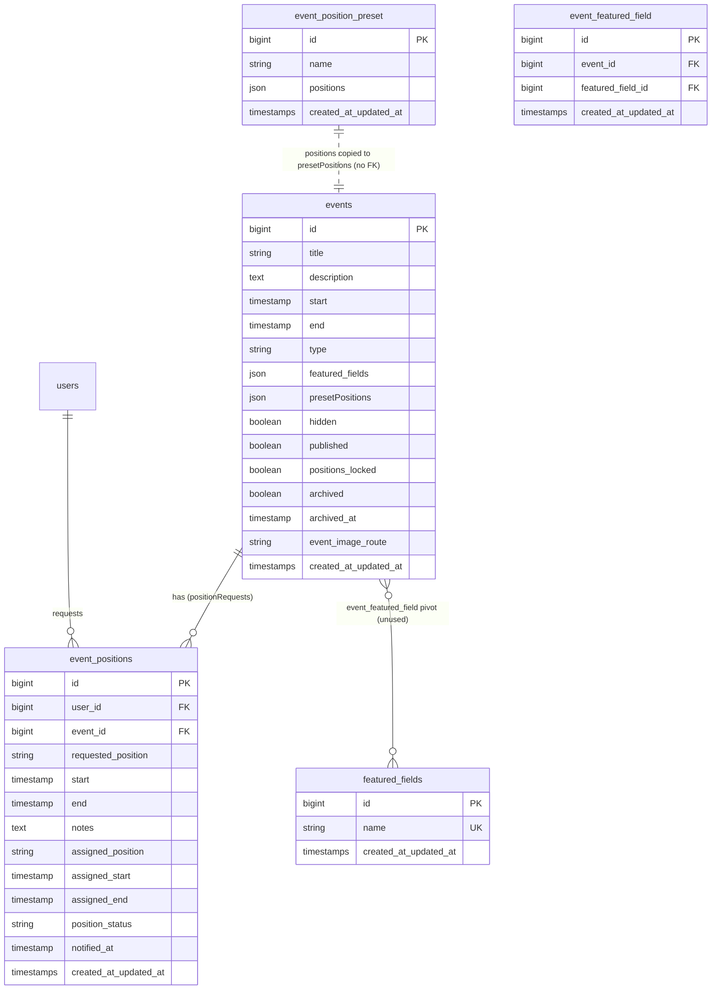

# Events System

This document explains how events work on the ZJX ARTCC site: how staff create and manage
events, how members request a position, how staff assign and publish positions, and how
events are archived once they're over.

## Purpose

An **event** is a scheduled VATSIM activity (for example a Friday Night Operations session
or a group flight) that members can staff. The events system covers:

1. **Event management:** staff in the Events department create, edit, hide, archive, and
   delete events from the admin area.
2. **Reusable metadata:** two catalogs, *position presets* (named lists of ATC positions)
   and *featured fields* (named airport/ICAO tags), that can be reused across events.
3. **Registration:** signed-in members request a position on an event, choosing a
   start/end window and leaving optional notes.
4. **Assignment and publishing:** staff assign registrants to positions and publish the
   roster, which emails each assigned controller.
5. **Archiving:** finished events are archived and hidden automatically.

## Key concepts

- **Event** (`app/Models/Event.php`) is the core record. It has a `title`, an HTML
  `description` (sanitized with Purify on save), `start`/`end` timestamps, a `type`, an
  optional banner, an array of `featured_fields`, an array of `presetPositions` (the
  event's position list), and four flags: `hidden`, `published`, `positions_locked`, and
  `archived`.
- **Event type** (`app/Enums/EventType.php`) is a string-backed enum on the `type` column:
  `HOME`, `SUPPORT_REQUIRED`, `SUPPORT_OPTIONAL`, `GROUP_FLIGHT`,
  `FRIDAY_NIGHT_OPERATIONS`, `SATURDAY_NIGHT_OPERATIONS`, `TRAINING`.
- **Banner:** new uploads are stored on the `public` disk under `event/` as
  `event_{id}.{ext}`. `Event::bannerStoragePath()` only returns paths under `event/` or
  the legacy `events/` directory. The browser URL comes from the disk (`banner_url`
  accessor), so a CDN or asset host works.
- **Featured field** (`app/Models/FeaturedField.php`) is a named tag, usually an airport
  ICAO such as `KMCO`, stored uppercased in `featured_fields`. It's the picklist for an
  event's featured fields.
- **Position preset** (`app/Models/EventPositionPreset.php`) is a named, reusable list of
  ATC positions stored as JSON in `event_position_preset`. Its positions are *copied*
  onto an event, either at creation or later from the positions page.
- **Event position / registration** (`app/Models/EventPosition.php`) is one row in
  `event_positions` per member per event. It holds what the member asked for
  (`requested_position`, `start`/`end`, `notes`) and what staff assigned
  (`assigned_position`, `assigned_start`/`assigned_end`, `position_status`), plus
  `notified_at` to track whether the member has been emailed about their current
  assignment.
- **Flags:**
  - `hidden`: the event isn't shown on the public calendar, and its page returns 404 to
    anyone without `manage events`.
  - `positions_locked`: the registration lock, which staff toggle to open or close
    position requests. New events are locked by default.
  - `published`: the assigned-positions roster is shown on the event page, and assigned
    members are emailed.
  - `archived`: the event is over. Archived events are always hidden.

## Data model

Notes on the schema:

- `event_positions` has a unique index on `(user_id, event_id)` and cascade-deletes with
  its user or event. `position_status` defaults to `pending` and becomes `assigned` when
  staff save an assignment.
- `events.published` defaults to `false`, and `events.positions_locked` defaults to
  `true`.
- `event_position_preset` is singular (set via `$table` on the model).
- `featured_fields.name` is unique. The `event_featured_field` pivot exists but isn't used
  (see Gotchas).
- An `event_position_assignments` table and an empty `EventPositionAssignment` class also
  exist from an earlier design. Nothing reads or writes them. Assignments live on
  `event_positions`.
- The events table has been reshaped by many migrations (for example `name` → `title`,
  `image_url` → `event_image_route`). Use the model's `$fillable` and `$casts` as the
  current column list.

## Flows

### 1. Create or edit an event

1. Staff open `GET /admin/events/create` → `EventManagementController::create()`. If the
   URL has `?staffing_request={id}`, the title and description are pre-filled from that
   [staffing request](staffing-requests.md).
2. The form posts to `POST /admin/events` → `store()`. Validation requires `title`,
   `description`, `start`, `end` (at least 1 hour after `start`), and a valid `type`.
   `featured_fields` is an optional comma-separated string. `presetPositions` is an
   optional preset name that must exist. `image` is an optional banner: JPEG, PNG, GIF,
   or WebP, up to 8 MB. SVG isn't allowed.
3. The description is sanitized with Purify, the chosen preset's positions are copied
   onto `presetPositions`, and the banner is stored with an extension taken from the
   file's contents, not the uploaded filename.
4. Editing (`GET /admin/events/{event}/edit`, `PUT /admin/events/{event}` →
   `update()`) uses the same rules, except that the preset can't be changed there. A new
   banner replaces the old file. Deleting (`DELETE /admin/events/{event}` →
   `destroy()`) also deletes the banner.

### 2. Toggles on the admin list

From `GET /admin/events` (`EventManagementController::index()`, `event-table`
Livewire) and the per-event manage page (`GET /admin/events/{event}/manage`), staff can:

- Toggle visibility: `PATCH /admin/events/{event}/visibility`. This is refused for
  archived events.
- Toggle archived: `PATCH /admin/events/{event}/archived` (see
  [Archiving](#6-archiving)).
- Toggle the registration lock: `PATCH /admin/events/{event}/positions-locked`.

The manage page also shows the registrants and the most-requested position.

### 3. A member requests a position

1. The public calendar (`GET /events`, `events-calendar` Livewire) shows non-hidden
   events month by month. `GET /events/{event}` → `EventController::show()` shows one
   event. Hidden or archived events return 404 unless the viewer has `manage events`.
2. If the member is signed in and registration is open, the page embeds the
   `event-registration` Livewire component. `mount()` loads the event's
   `presetPositions` and pre-fills the form if the member already registered.
3. `EventRegistration::store()` validates the position, optional notes (max 500), and a
   start/end window inside the event's times and at least 30 minutes long. It then
   creates the `event_positions` row with status `pending`. Times are entered and shown
   in UTC.
4. `EventRegistration::destroy()` withdraws the request by deleting the row.

A member's own registrations are listed at `GET /users/{user}/registered-events`.
Other users can see that page only if they have `assign event positions`.

### 4. Staff manage the position list

`GET /admin/events/{event}/positions` → `EventManagementController::positions()` embeds
the `event-positions-management` component. Users with `assign event positions` get full
access. Users with only `manage events` get a read-only view.

- Add a position (uppercased and de-duplicated), remove a position, or replace the list
  from a preset. Every change saves straight to `presetPositions`.
- A position can't be removed while any registrant is assigned to it.

### 5. Staff assign and publish

The same positions page embeds the `event-registrants` component:

1. Each registrant row starts with their requested times, and staff choose an assigned
   position and times.
2. **Save all** (`saveAll()`, requires `assign event positions`) only writes rows that
   changed since the page loaded. Each saved row gets `position_status = assigned`.
3. **Publish** (`publishPositions()`, requires `publish events`) sets `published = true`.
   It then emails `EventPositionAssigned` to every assigned registrant with no
   `notified_at`, and stamps `notified_at`. Publishing again doesn't re-email people who
   have already been told.
4. While the event is published, saving a changed assignment emails that registrant an
   "assignment updated" version straight away. While it's unpublished, a change clears
   `notified_at`, so the next publish emails them.
5. **Unpublish** (`unpublishPositions()`) hides the roster from the event page again.

When published, the event page shows the roster: every position in `presetPositions`,
plus any assigned position no longer in that list, with the assigned controllers and
times.

### 6. Archiving

Events are archived, not deleted, once they're over.

- **Automatically:** the `ArchiveEvents` job (`app/Jobs/ArchiveEvents.php`) runs every
  five minutes from `routes/console.php`. It finds events with no `archived_at` whose
  `end` is at least 24 hours in the past and sets `archived = true`, `hidden = true`, and
  `archived_at = now()`, in chunks of 100.
- **Manually:** the archived toggle (`EventManagementController::toggleArchived()`)
  archives an event straight away, or un-archives it. Un-archiving clears `archived` and
  `archived_at` but leaves the event hidden.

### 7. Catalogs

- **Position presets** are a full resource under `EventPositionPresetController`
  (`admin.events.position-presets.*`). `store()`/`update()` take a comma-separated
  `positions` string and save it as the JSON array.
- **Featured fields** (`EventFieldController`, `admin.events.event-fields.*`) support
  list, add (uppercased, unique), and remove. A field can't be removed while any event's
  `featured_fields` JSON still contains it.

## Permissions & middleware

| Route / action | Requirement |
| --- | --- |
| `GET /events`, `GET /events/{event}` | Public. Hidden or archived events need `manage events`. `{event}` must be numeric. |
| Request or withdraw a position | Signed in (`auth`). |
| `GET /users/{user}/registered-events` | The user themselves, or `assign event positions`. |
| Everything under `/admin/events` | `admin` prefix (`view dashboard`) + `manage events` |
| `GET /admin/events/{event}/positions` | Also needs `manage events` (read-only) or `assign event positions` (full). |
| Edit the position list, save assignments | `assign event positions`, re-checked inside the Livewire actions. |
| Publish / unpublish positions | `publish events`, re-checked inside the Livewire action. |

`PermissionSeeder` gives the `events` role `manage events`, `assign event positions`, and
`publish events`. See [authentication & authorization](../authentication-authorization.md).

## Background jobs & mail

| Class | Trigger | Recipient |
| --- | --- | --- |
| `ArchiveEvents` (job) | Every five minutes | None |
| `EventPositionAssigned` (mail) | Publish, or an assignment changed while published | The assigned registrant |

## Key files

| Concern | File |
| --- | --- |
| Public event controller | `app/Http/Controllers/Events/EventController.php` |
| Admin event management (CRUD, visibility, archive, lock, positions page) | `app/Http/Controllers/Events/EventManagementController.php` |
| Featured-field controller | `app/Http/Controllers/Events/EventFieldController.php` |
| Position-preset resource controller | `app/Http/Controllers/Events/EventPositionPresetController.php` |
| Event model | `app/Models/Event.php` |
| Event position / registration model | `app/Models/EventPosition.php` |
| Position preset model | `app/Models/EventPositionPreset.php` |
| Featured field model | `app/Models/FeaturedField.php` |
| Event type enum | `app/Enums/EventType.php` |
| Public calendar (Livewire) | `app/Livewire/EventsCalendar.php` |
| Registration form (Livewire) | `app/Livewire/EventRegistration.php` |
| Position list editor (Livewire) | `app/Livewire/EventPositionsManagement.php` |
| Assignment and publishing (Livewire) | `app/Livewire/EventRegistrants.php` |
| Admin events table (Livewire) | `app/Livewire/EventTable.php` |
| Preset table (Livewire) | `app/Livewire/PositionPresetTable.php` |
| Assignment email | `app/Mail/EventPositionAssigned.php`, `resources/views/mail/event-position-assigned.blade.php` |
| Archiving job | `app/Jobs/ArchiveEvents.php` |
| Views | `resources/views/events/`, `resources/views/livewire/event*.blade.php`, `resources/views/position-presets/`, `resources/views/event-fields/` |
| Migrations | `database/migrations/*event*` |

## Gotchas

- **Livewire actions must check permissions themselves.** Livewire's update endpoint
  doesn't run the page's route middleware, so `EventRegistrants` and
  `EventPositionsManagement` re-check `assign event positions` / `publish events` in
  every action that changes data. Do the same for any new action.
- **Un-archiving a finished event doesn't stick.** `ArchiveEvents` selects on
  `archived_at IS NULL`, and un-archiving clears `archived_at`. Any event whose `end` is
  more than 24 hours ago is re-archived on the job's next run (within five minutes). To
  bring an old event back, its `end` has to move into the last 24 hours or later.
- **Featured fields are stored as JSON on the event.** `events.featured_fields` is a JSON
  array filled from a comma-separated string in the forms. The `event_featured_field`
  pivot and `FeaturedField::events()` exist but aren't used.
- **Presets are copied, not linked.** Editing a preset later doesn't change events
  already created from it. Reload it from the positions page instead.
- **Registrations survive position changes.** A member's `requested_position` can name a
  position that has since been removed from the event. Assigned positions are protected
  from removal, but requests aren't.
- **`CreateEvent` (Livewire) is unused scaffolding.** Its `save()` is empty, and events
  are created through `EventManagementController::store()`.
- **`EventPositionAssignmentController` is unrouted.** See
  [discrepancies](../discrepancies.md) §5.6.
