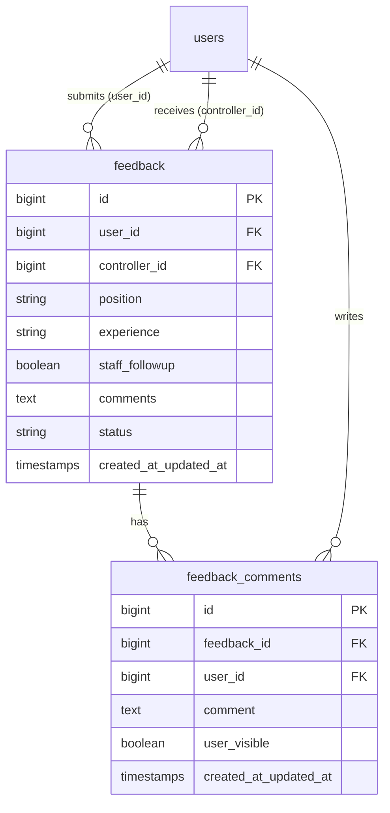
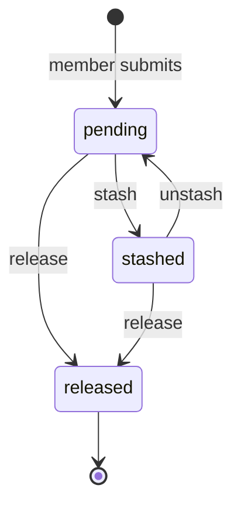

# Feedback

## Purpose

This document describes how pilots and other members leave feedback on ZJX controllers,
how staff review it before the controller sees it, and what happens when it is released.
It is written for developers and contributors working on the feedback form, the staff
review screens, or the notifications that go out on release.

## Key concepts

- **Feedback** is one submission about one controller on one position: an experience
  rating, free-text comments, and an optional request for staff follow-up.
- **Staff moderate everything first.** New feedback starts as `pending` and is only
  visible to staff. Staff can **stash** it (set it aside) or **release** it. Only released
  feedback is shown to the controller.
- **The submitter stays anonymous to the controller.** The controller's profile page, the
  "feedback received" email, and the Discord webhook post show the position, experience,
  and comments, but never who submitted it. Only staff with `feedback:read` see the
  submitter.
- **Staff comments** are internal notes on a feedback item. A comment can be marked
  *user-visible*, in which case the submitter sees it on their own feedback page and is
  emailed.
- **Rostered controllers can't submit feedback.** The form is meant for pilots and
  visitors, so users with the `rostered` role get a 403 on submit.

## Data model

Notes on the schema:

- The table is `feedback` (singular, set via `$table` on the model).
- `experience` is cast to `FeedbackExperience` (`Outstanding`, `Very Good`, `Good`,
  `Okay`, `Poor`). The string value is what's stored.
- `status` is cast to `FeedbackStatus` (`pending`, `stashed`, `released`) and defaults
  to `pending` at the database level.
- `feedback_comments` cascade-deletes with its parent `feedback` row. `user_visible`
  defaults to `false`.
- `Feedback` uses Scout's `Searchable` trait (collection driver; see
  [architecture](../architecture.md#infrastructure-drivers)) so staff can search by
  submitter, controller, position, experience, or status.

### Status lifecycle

## Flows

### 1. A member submits feedback

1. A logged-in member opens `GET /feedback/new` (`/feedback` redirects there) →
   `FeedbackController::index()`. The page lists rostered controllers to choose from, the
   experience options, and the member's own past submissions with any user-visible staff
   comments.
2. The form posts to `POST /feedback` → `FeedbackController::store()`. Users with the
   `rostered` role are rejected with a 403.
3. Validation requires a `controller_id` that belongs to a rostered user, a `position`
   (max 255), an `experience` from `FeedbackExperience`, and `comments` (max 5000).
   `staff_followup` is an optional boolean.
4. A `feedback` row is created with status `pending`. **No notification is sent at this
   point.** Staff find new feedback by checking the admin list.

### 2. Staff review

- `GET /admin/feedback` → `FeedbackController::manage()` lists feedback 25 per page, with
  an optional `search` term (max 255) run through Scout.
- `GET /admin/feedback/{feedback}` → `FeedbackController::show()` shows the full item,
  including the submitter, the controller, and all staff comments.
- `PUT /admin/feedback/{feedback}/stash` and `.../unstash` move an item between `stashed`
  and `pending`.
- `POST /admin/feedback/{feedback}/comments` → `storeComment()` adds a staff comment
  (max 5000). If `user_visible` is checked, the submitter is emailed
  (`FeedbackCommentPosted`).

### 3. Staff release feedback

`PUT /admin/feedback/{feedback}/release` → `FeedbackController::release()`:

1. Sets the status to `released` with a conditional update (`WHERE status != released`),
   so two staff clicking release at the same time can't both send notifications. The
   losing request gets an "already been released" error.
2. Dispatches `SendFeedbackToWebhook`, which posts an embed to the configured Discord
   webhook with the controller's name and CID, position, experience, and comments.
3. Queues `FeedbackReleased` to the submitter and `FeedbackReceived` to the controller.

### 4. The controller reads their feedback

`GET /users/{user}/feedback` → `UserController::feedback()` shows that user's released
feedback, 10 per page. Pending and stashed feedback never appear here.

## Permissions & middleware

| Route(s) | Middleware / check |
| --- | --- |
| `GET /feedback/new`, `POST /feedback` | `auth`. `store()` also rejects the `rostered` role. |
| `GET /users/{user}/feedback` | `auth`, and the viewer must be that user or have `feedback:read`. |
| `GET /admin/feedback`, `GET /admin/feedback/{feedback}` | `admin` prefix (`view dashboard`) + `feedback:read` |
| `PUT .../stash`, `.../unstash`, `.../release`, `POST .../comments` | `admin` prefix (`view dashboard`) + `feedback:write` |

`PermissionSeeder` grants `feedback:read` and `feedback:write` to the `staff` and `admin`
roles, and `feedback:read` only to the `events` role. See
[authentication & authorization](../authentication-authorization.md).

## Background jobs & mail

| Class | Trigger | Recipient |
| --- | --- | --- |
| `SendFeedbackToWebhook` (job) | Release | The Discord channel behind `FEEDBACK_WEBHOOK` |
| `FeedbackReleased` (mail) | Release | Submitter |
| `FeedbackReceived` (mail) | Release | Controller |
| `FeedbackCommentPosted` (mail) | User-visible staff comment | Submitter |

All of these are queued, so a queue worker must be running (see
[deployment](../deployment.md#queue-worker)). The webhook URL is read from
`config('app.feedback_webhook_url')`, which comes from the `FEEDBACK_WEBHOOK` env var.
Treat it as a secret: anyone with the URL can post to the channel. Keep it in the
deployment environment, never in the repo or in docs.

In local/development, the dev-only `/test-email/feedback-*` routes render each mailable
against the latest record so you can preview them in the browser.

## Key files

| Path | Role |
| --- | --- |
| `app/Http/Controllers/FeedbackController.php` | Submit, list, review, stash/unstash, release, comment. |
| `app/Http/Controllers/UserController.php` (`feedback()`) | Controller's released-feedback tab on their profile. |
| `app/Models/Feedback.php` | Model, relations (`user`, `controller`, `staffComments`, `visibleComments`), Scout fields. |
| `app/Models/FeedbackComment.php` | Staff comment model. |
| `app/Enums/FeedbackStatus.php` | `pending` / `stashed` / `released`. |
| `app/Enums/FeedbackExperience.php` | Experience rating options. |
| `app/Jobs/SendFeedbackToWebhook.php` | Discord post on release. |
| `app/Mail/Feedback*.php`, `resources/views/mail/feedback-*.blade.php` | Notification emails. |
| `resources/views/feedback/index.blade.php` | Member submission form and history. |
| `resources/views/manage-feedback/` | Staff list and detail views. |
| `resources/views/users/feedback.blade.php` | Controller's profile tab. |
| `database/factories/FeedbackFactory.php` | Factory for tests. |
| `tests/Feature/FeedbackTest.php` | Feature tests. |

## Gotchas

- **Nothing notifies staff about new submissions.** Feedback only surfaces when someone
  checks `/admin/feedback`. The webhook and emails fire on *release*, not on submit.
- **`staff_followup` is informational only.** It's shown to staff, but nothing in the code
  acts on it.
- **The webhook needs `FEEDBACK_WEBHOOK` set.** If it isn't, `SendFeedbackToWebhook` has
  no URL to post to and the job fails. The status change and the emails still happen,
  because they don't depend on the job.
- **Released feedback is final in the UI.** There's no "un-release" action, so check an
  item before releasing it. The controller is emailed immediately.
