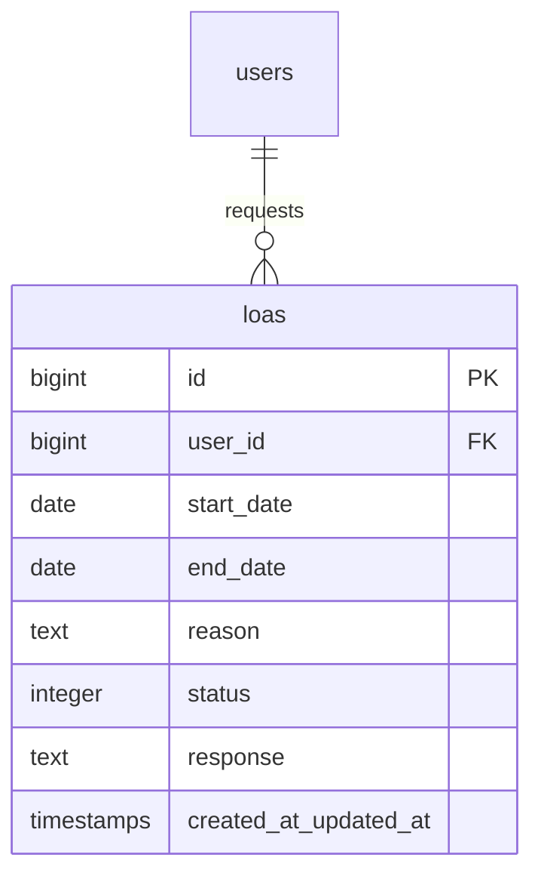
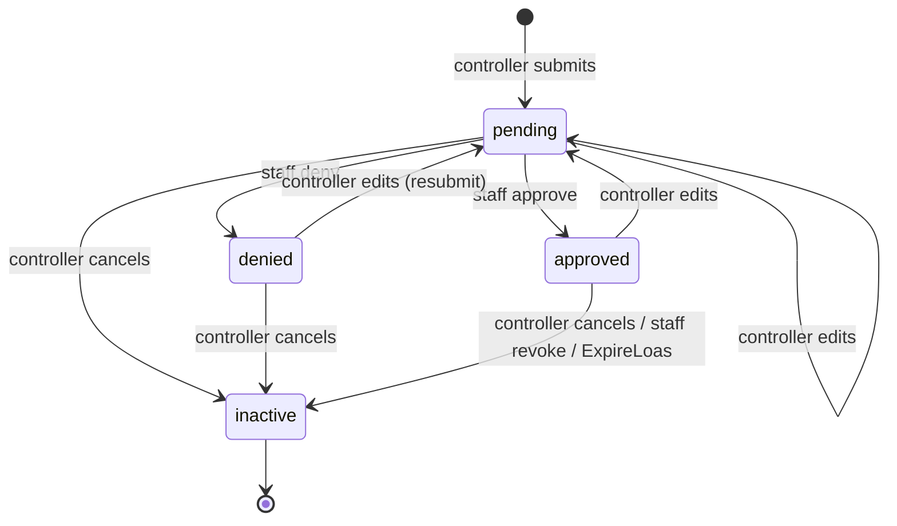

# Leave of Absence (LOA)

## Purpose

This document describes how rostered controllers request a leave of absence (LOA), how
staff approve, deny, or revoke it, and how LOAs expire. It is written for developers and
contributors working on the LOA pages, the review screens, or the expiry job.

## Key concepts

- **An LOA** is a dated request (`start_date` to `end_date`) with a reason, submitted by
  the controller who is going on leave.
- **One live LOA per user.** A user can't submit a new LOA while they have one in any
  status other than `inactive`. That includes `pending`, `approved`, *and* `denied`.
- **Staff decide.** Users with `manage loas` approve or deny pending requests and can
  revoke approved ones. Each decision can include a written `response` to the controller.
- **Expiry is automatic.** The daily `ExpireLoas` job marks approved LOAs inactive once
  their end date has passed.
- **`inactive` is the terminal state.** Cancelled, revoked, and expired LOAs all end up
  `inactive`, and an inactive LOA can't be edited or cancelled again.
- **LOAs affect the roster purge.** Users with an approved LOA are flagged "On LOA" in the
  inactivity purge tool and skipped on removal. See
  [roster & membership](roster-and-membership.md).

## Data model

Notes on the schema:

- `user_id` cascade-deletes with the user.
- `status` is an integer cast to `LoaStatus`: `0` pending, `1` approved, `2` denied,
  `3` inactive. It defaults to `0`.
- `response` is the staff reply shown to the controller. It was originally created as
  `admin_notes` and renamed by a later migration.
- `start_date` and `end_date` are cast to `date`.
- `User::loas()` returns a user's LOAs newest first.
- `Loa` uses `LogsActivity` and logs `user_id`, `start_date`, `end_date`, `status`, and
  `response` to the audit log (see [audit logging](audit-logging.md)). The free-text
  `reason` is deliberately left out of the audit log.

### Status lifecycle

## Flows

### 1. A controller requests an LOA

1. The controller opens the LOA tab on their own profile, `GET /users/{user}/loa` →
   `UserController::loa()`. It shows their current non-inactive LOA (if any) and a
   paginated history of inactive ones. Other users get a 403, including staff. Staff use
   the admin screens instead.
2. The form posts to `POST /loa` → `LoaController::store()`. If the user already has a
   non-inactive LOA, they're redirected back with an error.
3. Validation (`validateLoa()`): `start_date` must be today or later, `end_date` must be
   after `start_date` and at least 7 days after it, and `reason` is required (max 1000).
4. The LOA is created as `pending`. `LoaSubmitted` is queued to the controller, with the
   facility's VATUSA EC role address on BCC (`{vatusa_facility}-ec@vatusa.net`, i.e.
   `zjx-ec@vatusa.net`).

### 2. The controller edits or cancels

- **Edit:** `PUT /loa/{loa}` → `LoaController::update()`. Only the owner can edit, and not
  once it's `inactive`. The same validation applies, and **any edit resets the status to
  `pending`**, even on an approved LOA, so it has to be reviewed again. No email is sent.
- **Cancel:** `DELETE /loa/{loa}` → `LoaController::destroy()`. Only the owner can cancel.
  The LOA becomes `inactive` and `LoaDeleted` is queued to the controller. The row is
  kept, not deleted.

### 3. Staff review

- `GET /admin/loas` → `LoaController::manage()` lists all LOAs, pending first, then newest
  first, 25 per page.
- `GET /admin/loas/{loa}` → `LoaController::show()` shows one LOA and its owner.
- `PUT /admin/loas/{loa}/approve` and `.../deny` only work on `pending` LOAs. They set the
  status, store the optional `response` (max 1000), and queue `LoaApproved` or
  `LoaDenied` to the controller.
- `PUT /admin/loas/{loa}/revoke` only works on `approved` LOAs. It sets the LOA to
  `inactive`, stores the optional `response`, and queues `LoaRevoked`.

Each staff action is also written to the application log with the acting user's ID.

### 4. Expiry

`ExpireLoas` (`app/Jobs/ExpireLoas.php`) runs daily from `routes/console.php`. It finds
`approved` LOAs whose `end_date` is before today, sets each one to `inactive`, and queues
`LoaExpired` to the controller with the ATM and DATM on BCC (looked up from the `staff`
table).

## Permissions & middleware

| Route(s) | Middleware / check |
| --- | --- |
| `GET /users/{user}/loa` | `auth`, and the viewer must be that user. |
| `POST /loa` | `auth` |
| `PUT /loa/{loa}`, `DELETE /loa/{loa}` | `auth`, and the controller checks that the user owns the LOA (403 otherwise). |
| `GET /admin/loas`, `GET /admin/loas/{loa}`, `PUT .../approve`, `.../deny`, `.../revoke` | `admin` prefix (`view dashboard`) + `manage loas` |

`PermissionSeeder` grants `manage loas` to the `admin` role. See
[authentication & authorization](../authentication-authorization.md).

## Background jobs & mail

| Class | Trigger | Recipient |
| --- | --- | --- |
| `LoaSubmitted` | Controller submits | Controller, facility EC address on BCC |
| `LoaApproved` | Staff approve | Controller |
| `LoaDenied` | Staff deny | Controller |
| `LoaRevoked` | Staff revoke | Controller |
| `LoaDeleted` | Controller cancels | Controller |
| `ExpireLoas` (job) → `LoaExpired` | Daily, for approved LOAs past their end date | Controller, ATM/DATM on BCC |

All mail is queued, so a queue worker must be running, and `ExpireLoas` needs the
scheduler (see [deployment](../deployment.md#scheduler)).

## Key files

| Path | Role |
| --- | --- |
| `app/Http/Controllers/LoaController.php` | Submit, edit, cancel, staff list/show/approve/deny/revoke, shared validation. |
| `app/Http/Controllers/UserController.php` (`loa()`) | Controller's LOA tab on their profile. |
| `app/Models/Loa.php` | Model, casts, audit-log options. |
| `app/Enums/LoaStatus.php` | `PENDING` / `APPROVED` / `DENIED` / `INACTIVE` (integer-backed). |
| `app/Jobs/ExpireLoas.php` | Daily expiry. |
| `app/Mail/Loa*.php`, `resources/views/mail/loa-*.blade.php` | Notification emails. |
| `resources/views/users/loa.blade.php` | Controller's request form, current LOA, and history. |
| `resources/views/loa/manage.blade.php`, `resources/views/loa/show.blade.php` | Staff list and detail views. |
| `database/migrations/*loas*` | Table creation and the `admin_notes` → `response` rename. |

## Gotchas

- **A denied LOA blocks new requests.** `store()` treats every non-`inactive` status as
  live, so a controller whose LOA was denied has to edit it (which resubmits it) or cancel
  it before they can create a fresh one.
- **Pending LOAs never expire.** `ExpireLoas` only looks at `approved` LOAs. A request
  that's never reviewed stays `pending` after its dates have passed and keeps blocking new
  submissions until someone acts on it.
- **Editing an approved LOA un-approves it.** `update()` always resets to `pending`. The
  controller is no longer "On LOA" for the roster purge until staff approve it again.
- **Submissions aren't emailed to the reviewers directly.** The submit email goes to the
  controller with the facility EC address on BCC. People with `manage loas` otherwise need
  to check `/admin/loas`.
- **There are no LOA feature tests yet.** Add Pest coverage under `tests/Feature/` when
  changing this system.
