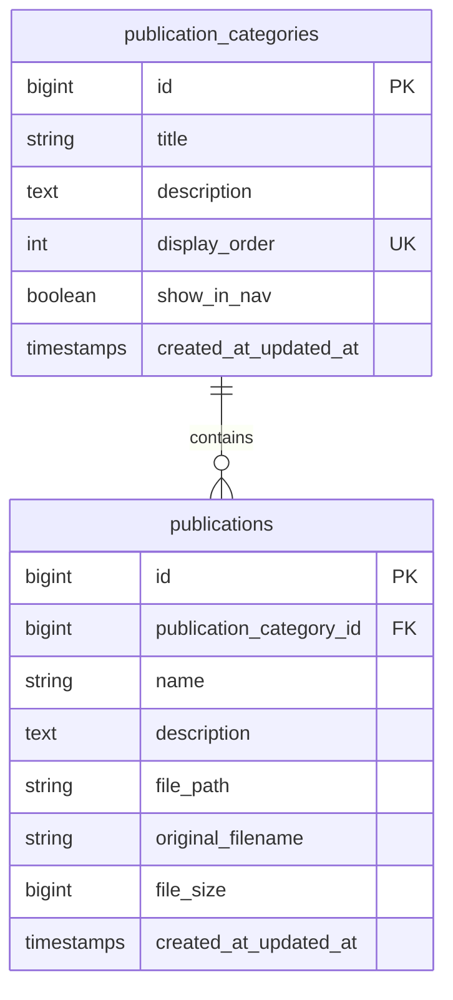

# Site Content: News, Publications, and FAQs

## Purpose

This document covers the three staff-edited content areas of the site: **news**
announcements on the home page, downloadable **publications** (SOPs, LOAs, vATIS
profiles, and other documents), and the public **FAQ** page. It is written for developers
and contributors working on any of those pages or their admin screens.

---

## News

### Key concepts

- A news item is a title (max 100) and rich-text `content`, stamped with `published_at`
  when it's created.
- The home page (`HomeController`) and the dashboard (`DashboardController`) show the
  three most recent items with `published_at` up to now.
- Only users with the `admin` **role** can manage news. This is a role check, not a
  permission.

### Data model

| Column | Type | Notes |
| --- | --- | --- |
| `id` | bigint | PK |
| `title` | string | Max 100 on input. |
| `content` | text | Sanitized with Purify on save, and again when the home page renders it. |
| `published_at` | timestamp | Set to `now()` on create. Not editable. |

### Flows and routes

All under the `admin` prefix (`view dashboard`) + `role:admin`:

| Route | Action |
| --- | --- |
| `GET /admin/news` | `NewsController::index()`: every item, newest first, 25 per page. |
| `GET /admin/news/create`, `POST /admin/news` | Create. Redirects to the home page. |
| `GET /admin/news/{news}/edit`, `PUT /admin/news/{news}` | Edit title and content. |

### Gotchas

- **There's no delete or unpublish.** Removing a news item needs a database change.
- **There's no scheduling in the UI.** The `published_at <= now()` filter exists, but
  create always uses `now()`.

---

## Publications

### Key concepts

- **Categories** (`PublicationCategory`) group documents. Each has a `title`, an optional
  `description`, a unique `display_order`, and a `show_in_nav` flag for the mobile menu.
- **Publications** (`Publication`) are uploaded files with a `name`, optional
  `description`, and category.
- **Public listing:** `GET /publications/downloads` lists every category, in display
  order, with its documents sorted by name.
- **Serving files:** `GET /publications/{publication}/file` serves the stored file under
  its original filename. PDFs and PNG/JPEG images open in the browser. Anything else,
  including vATIS profile JSON, downloads.
- **Allowed uploads:** `pdf`, `png`, `jpg`/`jpeg`, and `json`, up to 10 MB. The file's
  contents must match its extension (`Publication::ALLOWED_TYPES`).

### Data model

- Files are stored on the `public` disk under `documents/` with generated names
  (`Publication::DISK`). See [deployment](../deployment.md) for disk and storage setup.
- Both models are audited (see [audit logging](audit-logging.md)).

### Flows and routes

All admin routes are under the `admin` prefix (`view dashboard`) +
`permission:documents:write`, named `admin.publications.*`:

| Route | Action |
| --- | --- |
| `GET /admin/publications` | List by category. |
| `GET .../create`, `POST /admin/publications` | Upload. A file is required. |
| `GET .../{id}/edit`, `PUT .../{id}` | Edit details. Uploading a new file replaces and deletes the old one. |
| `DELETE .../{id}` | Delete the record and its file. |
| `/admin/publications/categories/...` (`GET`, `POST`, `PUT`, `DELETE`) | Category list, create, edit, delete. |
| `PATCH .../categories/{id}/toggle-nav` | Toggle `show_in_nav`. |

- **Ordering:** creating or editing a category with a `display_order` moves it to that
  slot and renumbers the rest (`repositionAndNormalize()`). Opening the category list
  also renumbers (`normalizeOrder()`), which closes any gaps.
- **Deleting a category** is refused while it still has documents.

`PermissionSeeder` grants `documents:write` to the `admin` and `facilities` roles.

### Navbar caching

`PublicationCategory::forNavbar()` and `forMobileNav()` cache the category list forever
(`Cache::rememberForever`). The model's `saved` and `deleted` hooks clear both keys, so
changes through Eloquent show up straight away. A change made directly in the database
won't appear until the cache is cleared (`php artisan cache:clear`).

### Gotchas

- **Don't link to the storage path.** Use `$publication->file_url` (the
  `publications.file` route). It sets the content type from the stored bytes and adds
  `X-Content-Type-Options: nosniff`.
- **Older uploads may not be on the allowlist.** Files uploaded before the current
  allowlist (for example `.docx`) are served as `application/octet-stream` and download
  instead of opening.

---

## FAQs

### Key concepts

- An FAQ has a `category` (free text, default `General`), a `question`, a rich-text
  `answer` written in the Quill editor, a `sort_order` within its category, and an
  `is_published` flag.
- The public page (`GET /faq`, `Faqs` Livewire) shows published FAQs grouped by
  category, with a word search over questions and answers.
- The page heading and intro text are editable settings, stored as key/value rows in
  `faq_settings` (`faq_heading`, `faq_intro`). `FaqSetting::DEFAULTS` supplies the text
  until they're saved.

### Data model

| Table | Columns |
| --- | --- |
| `faqs` | `id`, `category`, `question`, `answer`, `sort_order`, `is_published` (default `true`), timestamps. Indexed on `(is_published, category, sort_order)`. |
| `faq_settings` | `id`, `key` (unique), `value` (nullable), timestamps. |

Both models are audited (see [audit logging](audit-logging.md)).

### Flows and routes

- `GET /faq` → `FaqController::index()` → `Faqs` component. Public.
- `GET /admin/faqs` → `FaqController::manage()` → `ManageFaqs` component. Needs the
  `admin` prefix (`view dashboard`) + `manage faqs`, which `PermissionSeeder` grants to
  the `staff` role.

`ManageFaqs` handles everything on one page:

- Create and edit FAQs. New FAQs go to the end of their category.
- Publish or unpublish, delete, and move up or down within a category.
- Rename a category (updates every FAQ in it) or delete a category.
- Edit the page heading and intro.

### Gotchas

- **Categories aren't a table.** A category exists as long as one FAQ uses that string, so
  renaming one means updating every row.
- **The migration comment says "Markdown",** but answers are stored as Quill HTML.

---

## Key files

| Path | Role |
| --- | --- |
| `app/Http/Controllers/News/NewsController.php` | News admin. |
| `app/Models/News.php` | News model. |
| `app/Http/Controllers/HomeController.php`, `DashboardController.php` | Show the latest news. |
| `app/Http/Controllers/PublicationsController.php` | Public listing and file serving. |
| `app/Http/Controllers/AdminPublicationsController.php` | Upload, edit, delete documents. |
| `app/Http/Controllers/AdminPublicationCategoriesController.php` | Category admin and ordering. |
| `app/Models/Publication.php`, `app/Models/PublicationCategory.php` | Models, allowlist, served type, nav cache. |
| `app/Http/Controllers/FaqController.php` | FAQ page shells. |
| `app/Livewire/Faqs.php`, `app/Livewire/ManageFaqs.php` | Public FAQ page and FAQ admin. |
| `app/Models/Faq.php`, `app/Models/FaqSetting.php` | FAQ models and settings defaults. |
| `resources/views/news/`, `resources/views/publications/`, `resources/views/admin/publications/`, `resources/views/faq/`, `resources/views/admin/faqs/` | Views. |
| `tests/Feature/PublicationsTest.php`, `tests/Feature/FaqTest.php` | Feature tests. |
