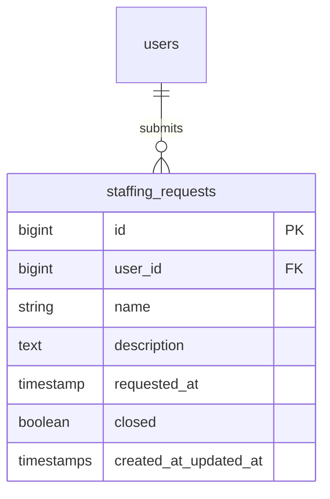

# Staffing Requests

## Purpose

This document describes how a pilot group, virtual airline, or other organiser asks ZJX to
staff an event, and how the events team reviews and closes those requests. It is written
for developers and contributors working on the request form or the admin screens.

## Key concepts

- **A staffing request** is a free-text ask: an event name, a description (up to 2000
  characters), and the date and time the organiser wants coverage.
- **Open or closed.** Requests start open. Staff close them once handled, and can reopen
  them. There are no other states.
- **Follow-up happens by email, outside the app.** The site records the request and
  confirms receipt. The events team then contacts the requester directly.
- **Requests can seed an event.** From a request's detail page, staff can open the
  create-event form with the title and description pre-filled (see
  [events](events.md#1-create-or-edit-an-event)).

## Data model

- `user_id` cascade-deletes with the user.
- `closed` defaults to `false`.
- `StaffingRequest` uses Scout's `Searchable` trait (collection driver), so staff can
  search by submitter or request name.

## Flows

### 1. Submit

1. A signed-in user opens `GET /staffing-requests` → `StaffingRequestController::index()`.
2. The form posts to `POST /staffing-requests` → `store()`. Validation requires `name`
   (max 255), `description` (max 2000), and a `requested_at` date.
3. The request is saved, `StaffingRequestSubmitted` is queued to the submitter, and the
   submission is written to the application log.

### 2. Review

- `GET /admin/staffing-requests` → `manage()` lists requests, open ones first and then
  newest first, 25 per page, with an optional `search` term (max 255).
- `GET /admin/staffing-requests/{staffingRequest}` → `show()` shows the full request and
  submitter, with a link to create an event from it
  (`/admin/events/create?staffing_request={id}`).

### 3. Close or reopen

- `PATCH /admin/staffing-requests/{staffingRequest}/close` → `close()` sets
  `closed = true` and queues `StaffingRequestClosed` to the submitter.
- `PATCH /admin/staffing-requests/{staffingRequest}/reopen` → `reopen()` sets
  `closed = false`. No email is sent.

Both actions are written to the application log with the acting user's ID.

## Permissions & middleware

| Route(s) | Requirement |
| --- | --- |
| `GET /staffing-requests`, `POST /staffing-requests` | `auth` |
| `GET /admin/staffing-requests`, `GET /admin/staffing-requests/{staffingRequest}` | `admin` prefix (`view dashboard`) + `staffing-requests:read` |
| `PATCH .../close`, `PATCH .../reopen` | `admin` prefix (`view dashboard`) + `staffing-requests:write` |

`PermissionSeeder` grants both permissions to the `admin` and `events` roles.

## Background jobs & mail

| Mailable | Trigger | Recipient |
| --- | --- | --- |
| `StaffingRequestSubmitted` | Submit | Submitter |
| `StaffingRequestClosed` | Close | Submitter |

Both are queued.

## Key files

| Path | Role |
| --- | --- |
| `app/Http/Controllers/StaffingRequestController.php` | Form, submit, list, show, close, reopen. |
| `app/Models/StaffingRequest.php` | Model, casts, Scout fields. |
| `app/Mail/StaffingRequest*.php` | Confirmation and closed emails. |
| `resources/views/staffing-requests/` | Public request form. |
| `resources/views/manage-staffing-requests/` | Staff list and detail views. |
| `database/migrations/*_create_staffing_requests_table.php` | Table. |
| `tests/Feature/StaffingRequestTest.php` | Feature tests. |

## Gotchas

- **Nothing notifies staff about new requests.** Only the submitter is emailed, so the
  events team has to check `/admin/staffing-requests`.
- **Creating an event doesn't close the request.** The pre-filled create-event link is a
  shortcut only. Close the request separately.
- **`requested_at` is a single timestamp,** not a start/end range. Put any duration in the
  description.
