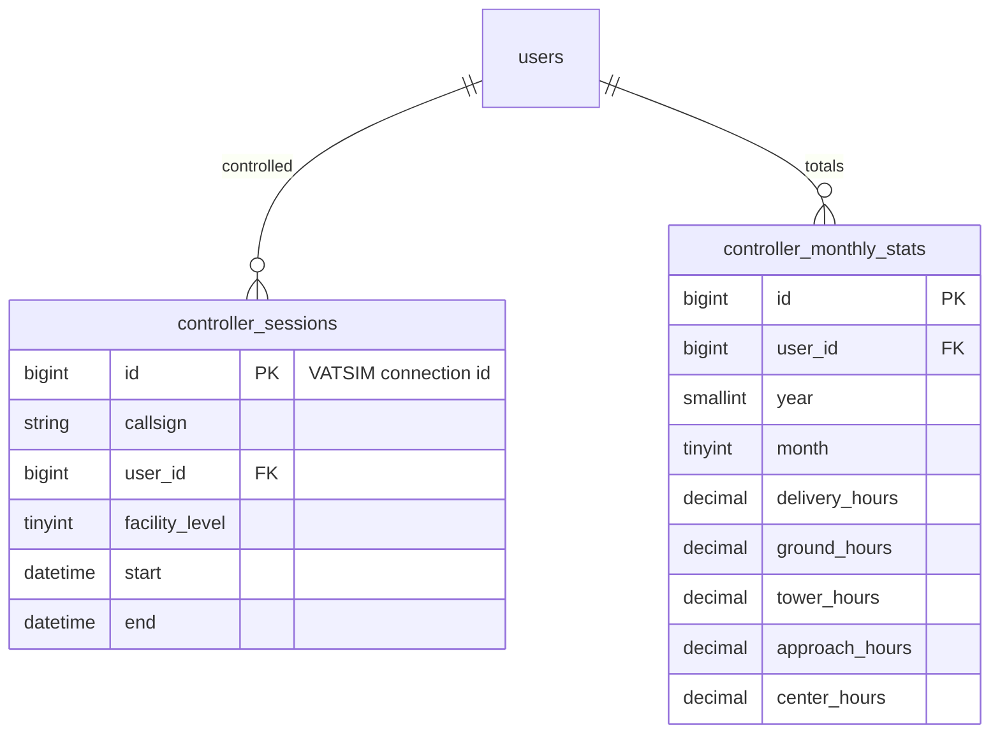

# Controller Statistics

## Purpose

This document describes the controller statistics page (a leaderboard of controlling
hours, plus a per-controller breakdown) and the data behind it. It is written for
developers and contributors working on the statistics page or its data. The import from
VATSIM is covered in detail in
[VATSIM integration](../vatsim-integration.md#vatsim-core-controller-statistics), and the
reasoning behind the design is in the
[statistics ADR](../adr/statistics-online-controller.md).

## Key concepts

- **Sessions** (`controller_sessions`) are individual historical connections imported
  from the VATSIM Core API by the `SyncVatsimSessions` job. Each one has a callsign, a
  controller, a facility level, and start and end times.
- **Monthly stats** (`controller_monthly_stats`) are per-controller, per-month totals of
  hours in five buckets: delivery, ground, tower, approach, and center. They're
  recomputed from sessions whenever an import touches a month. Months are counted by
  session start time, in UTC.
- **Only qualifying sessions are imported:** the callsign must match a configured
  [statistics prefix](roster-and-membership.md), the controller must be currently
  rostered, and the position suffix must be eligible.
- **Imports are idempotent.** Sessions are upserted by their VATSIM connection ID, so
  overlapping imports don't create duplicates.

## Data model

- Both tables cascade-delete with the user and have no timestamps.
- `controller_sessions.id` isn't auto-incrementing. It's the VATSIM connection ID.
- `controller_monthly_stats` is unique on `(user_id, year, month)`. Hours are
  `decimal(8,4)`, cast to `float`. `ControllerMonthlyStat::totalHours()` adds up the five
  buckets.

## Flows

### 1. View the statistics page

`GET /controllers/statistics` → `StatisticsController::index()` (signed-in users). Query
parameters:

- `year`: a year from 2000 to 2100, or `all`/`0`. Defaults to the current year. Out-of-range
  values fall back to the current year.
- `month`: 1 to 12, or `all`/`0`. Defaults to the current month.
- `cid`: optional controller ID for the per-controller view.

With no `cid`, the page shows a **leaderboard** of the period, sorted by total hours, with
per-bucket and overall totals. With a `cid`, it shows that controller's monthly rows
for the year and, when a single month is selected, their individual sessions. The page
also shows all-time total hours and the earliest month on record.

### 2. Import data

- **Scheduled:** every six hours, `routes/console.php` queues `SyncVatsimSessions` for
  the last 14 days (`StatisticsController::DEFAULT_LOOKBACK_DAYS`) through today.
- **From the admin dashboard:** `POST /admin/statistics/sync` →
  `StatisticsController::sync()` queues an import for a `from_date` to `to_date` range
  (whole UTC days). Requires `statistics:write`.
- **From the command line:** `php artisan statistics:sync [from] [to]` (UTC dates or
  datetimes, with the same defaults as the schedule) queues the same import. Useful for
  backfills.

All three only queue the job, so a queue worker has to be running for anything to
happen. The job pages through the API, queuing the next page itself, and retries a
failed page up to three times with back-off.

## Permissions & middleware

| Route / command | Requirement |
| --- | --- |
| `GET /controllers/statistics` | `auth` |
| `POST /admin/statistics/sync` | `admin` prefix (`view dashboard`) + `statistics:write` |
| `php artisan statistics:sync` | Server shell access |

`PermissionSeeder` grants `statistics:write` to the `facilities` role.

## Key files

| Path | Role |
| --- | --- |
| `app/Http/Controllers/StatisticsController.php` | Statistics page and manual sync. |
| `app/Models/ControllerSession.php` | Session model, `durationHours()`. |
| `app/Models/ControllerMonthlyStat.php` | Monthly totals model, `totalHours()`. |
| `app/Jobs/SyncVatsimSessions.php` | Paged import and monthly recompute. |
| `app/Console/Commands/SyncVatsimStatistics.php` | `statistics:sync` command. |
| `routes/console.php` | Six-hourly schedule. |
| `resources/views/statistics/index.blade.php` | Statistics page. |
| `database/migrations/*_create_controller_statistics_tables.php` | Both tables. |
| `tests/Feature/StatisticsLeaderboardTest.php`, `tests/Feature/VatsimStatisticsSyncTest.php` | Feature tests. |

## Gotchas

- **Leaving the roster stops new imports, but history stays.** Sessions only import for
  rostered controllers. Existing rows remain until the user is deleted, which cascades.
- **Prefix changes aren't retroactive.** Adding a prefix only affects sessions imported
  from then on. Run `statistics:sync` over the past range to pick up older sessions.
- **The default range is short.** The schedule only looks back 14 days. Anything older
  that was missed needs a manual sync.
